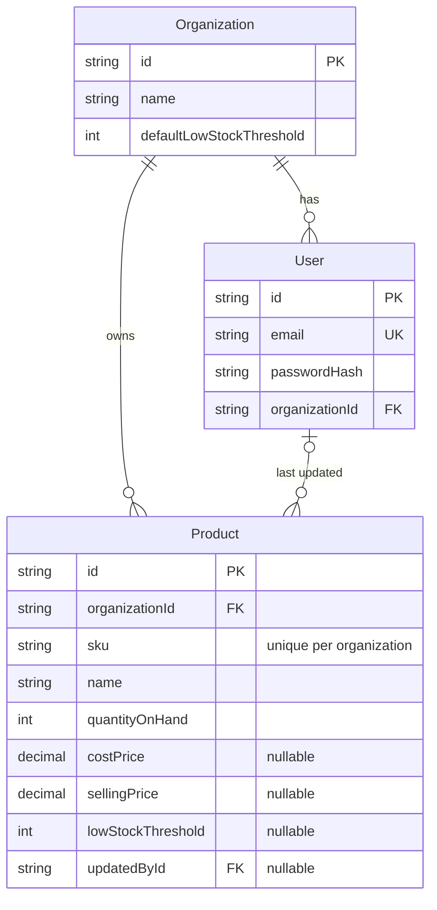

# StockFlow

Multi-tenant inventory SaaS: organizations manage products, stock levels and low-stock alerts.
Modular monolith (Express + Prisma) with a React SPA. Built stage by stage.

## Status

| Stage | Scope                             | Done |
| ----- | --------------------------------- | :--: |
| 0     | Monorepo, tooling                 | [x]  |
| 1     | Database foundation               | [ ]  |
| 2     | Express API foundation            | [ ]  |
| 3     | Authentication and tenant context | [ ]  |
| 4     | Product API                       | [ ]  |
| 5     | Dashboard and settings API        | [ ]  |
| 6     | Design system and app shell       | [ ]  |
| 7     | Temporary auth UI                 | [ ]  |
| 8     | Dashboard UI                      | [ ]  |
| 9     | Product management UI             | [ ]  |
| 10    | Settings UI                       | [ ]  |
| 11    | E2E, a11y, coverage               | [ ]  |
| 12    | Production deployment             | [ ]  |
| 13    | Docs and demo polish              | [ ]  |

## Local setup

Prerequisites: Node 20+.

```bash
npm install
cp backend/.env.example backend/.env     # then fill in secrets (see Database below)
cp frontend/.env.example frontend/.env
npm run db:deploy                        # apply migrations to your Neon database
npm run db:seed                          # optional: load demo data (DEV ONLY)
npm run dev     # API on :4000, web on :5173 (Vite proxies /api to the API)
```

Run the API alone with `npm run dev -w backend`. It validates its environment on startup and exits
with a readable list of invalid variable names (never values) if anything is missing.

Other scripts: `npm run build`, `lint`, `typecheck`, `test`, `format`.

## Layout

- `frontend`: React + Vite + Tailwind CSS
- `backend`: Express + TypeScript
- `packages/contracts`: shared types and Zod schemas (`@meridio/contracts`), built to `dist` before backend and frontend

See [docs/CODEMAP.md](docs/CODEMAP.md) for a file-by-file map.

## Database

PostgreSQL on [Neon](https://neon.tech), accessed with Prisma 7.10.1 (pinned exactly; the 8.x line is
still release-candidate). Development uses Neon too: there is no local database.

- `DATABASE_URL`: Neon **pooled** connection string. Used by the running API through the `pg` driver adapter.
- `DIRECT_URL`: Neon **direct** connection string. Used only by the Prisma CLI for migrations.
- `TEST_DATABASE_URL`: a **separate** Neon database (for example `stockflow_test`) used by tests, which
  empty its tables. The test helper refuses to run if it points at the dev database.



### Constraints

| Rule                                                    | Enforced by                           |
| ------------------------------------------------------- | ------------------------------------- |
| SKU unique per organization                             | `@@unique([organizationId, sku])`     |
| Email unique                                            | `@unique` (stored lowercase by app)   |
| `quantityOnHand`, prices, thresholds `>= 0`             | CHECK constraints (raw SQL migration) |
| Deleting an organization removes its users and products | `onDelete: Cascade`                   |
| Deleting a user keeps products, clears `updatedById`    | `onDelete: SetNull`                   |
| Fast `ILIKE '%x%'` search on name and SKU               | `pg_trgm` GIN indexes                 |

### Commands

| Command              | What it does                                         |
| -------------------- | ---------------------------------------------------- |
| `npm run db:migrate` | Create and apply a migration during development      |
| `npm run db:deploy`  | Apply existing migrations (non-interactive, safe)    |
| `npm run db:seed`    | Load demo data (idempotent)                          |
| `npm run db:studio`  | Open Prisma Studio                                   |
| `npm run db:reset`   | Wipe and re-migrate the database (**destroys data**) |

### Seeded demo logins (DEV ONLY)

Never run the seed against production. These passwords are public.

| Organization     | Email                  | Password       |
| ---------------- | ---------------------- | -------------- |
| Demo Store       | `demo@demostore.test`  | `DemoPass123`  |
| Northwind Supply | `owner@northwind.test` | `NorthPass123` |

`KEY-001` exists in both organizations to show that SKUs are unique per organization, not globally.

## API foundation

Versioned under `/api/v1`, with a uniform response envelope (`{ data }` / `{ error }`), documented
error codes, and a request-id on every response. Helmet, CORS limited to `APP_ORIGIN`, a 100 KB body
limit, an Origin check on state-changing requests, and `Cache-Control: private, no-store` are applied
globally. Logs are structured (pino) with passwords, cookies and auth headers redacted.

- `GET /api/v1/health/live`: process is up
- `GET /api/v1/health/ready`: database is reachable (use this as the platform health check)

See [docs/API.md](docs/API.md) for the envelope, error code table and endpoint reference.
