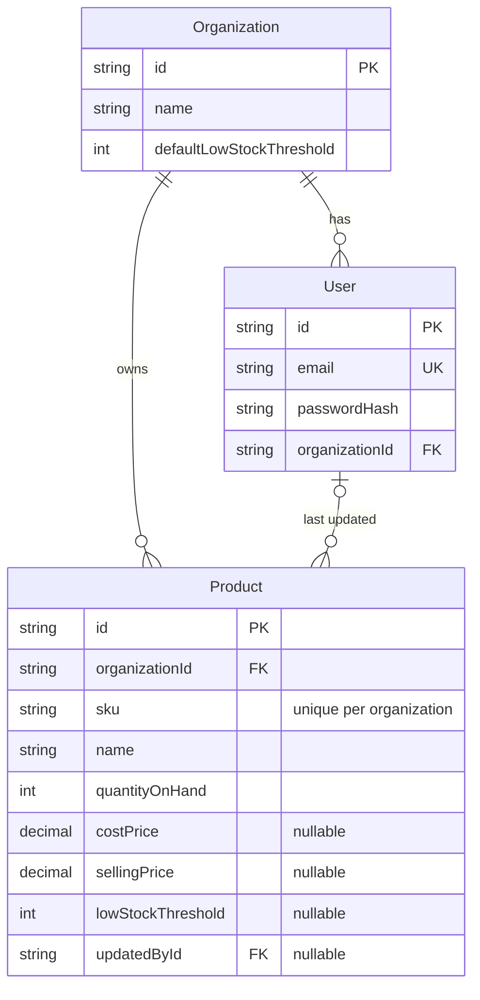
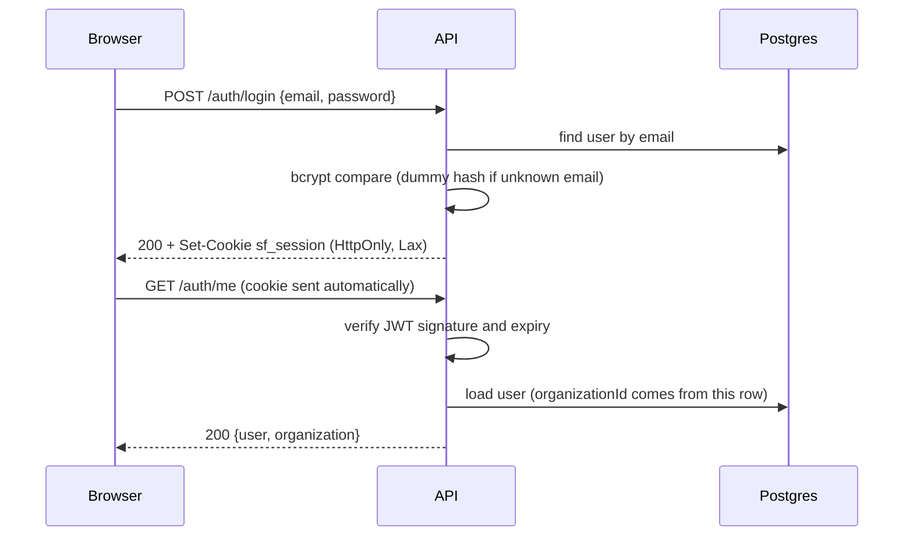

# StockFlow

Multi-tenant inventory SaaS: organizations manage products, stock levels and low-stock alerts.
Modular monolith (Express + Prisma) with a React SPA. Built stage by stage.

## Status

| Stage | Scope                             | Done |
| ----- | --------------------------------- | :--: |
| 0     | Monorepo, tooling                 | [x]  |
| 1     | Database foundation               | [x]  |
| 2     | Express API foundation            | [x]  |
| 3     | Authentication and tenant context | [x]  |
| 4     | Product API                       | [x]  |
| 5     | Dashboard and settings API        | [x]  |
| 6     | Design system and app shell       | [x]  |
| 7     | Temporary auth UI                 | [x]  |
| 8     | Dashboard UI                      | [x]  |
| 9     | Product management UI             | [ ]  |
| 10    | Settings UI                       | [ ]  |
| 11    | E2E, a11y, coverage               | [ ]  |
| 12    | Production deployment             | [ ]  |
| 13    | Docs and demo polish              | [ ]  |

## Local setup

Prerequisites: Node 20+.

```bash
npm install
cp backend/.env.example backend/.env     # then fill in secrets (see Database below)
cp frontend/.env.example frontend/.env
npm run db:deploy                        # apply migrations to your Neon database
npm run db:seed                          # optional: load demo data (DEV ONLY)
npm run dev     # API on :4000, web on :5173 (Vite proxies /api to the API)
```

Run the API alone with `npm run dev -w backend`. It validates its environment on startup and exits
with a readable list of invalid variable names (never values) if anything is missing.

Other scripts: `npm run build`, `lint`, `typecheck`, `test`, `format`.

## Layout

- `frontend`: React + Vite + Tailwind CSS
- `backend`: Express + TypeScript
- `packages/contracts`: shared types and Zod schemas (`@meridio/contracts`), built to `dist` before backend and frontend

See [docs/CODEMAP.md](docs/CODEMAP.md) for a file-by-file map.

## Database

PostgreSQL on [Neon](https://neon.tech), accessed with Prisma 7.10.1 (pinned exactly; the 8.x line is
still release-candidate). Development uses Neon too: there is no local database.

- `DATABASE_URL`: Neon **pooled** connection string. Used by the running API through the `pg` driver adapter.
- `DIRECT_URL`: Neon **direct** connection string. Used only by the Prisma CLI for migrations.
- `TEST_DATABASE_URL`: a **separate** Neon database (for example `stockflow_test`) used by tests, which
  empty its tables. The test helper refuses to run if it points at the dev database.



### Constraints

| Rule                                                    | Enforced by                           |
| ------------------------------------------------------- | ------------------------------------- |
| SKU unique per organization                             | `@@unique([organizationId, sku])`     |
| Email unique                                            | `@unique` (stored lowercase by app)   |
| `quantityOnHand`, prices, thresholds `>= 0`             | CHECK constraints (raw SQL migration) |
| Deleting an organization removes its users and products | `onDelete: Cascade`                   |
| Deleting a user keeps products, clears `updatedById`    | `onDelete: SetNull`                   |
| Fast `ILIKE '%x%'` search on name and SKU               | `pg_trgm` GIN indexes                 |

### Commands

| Command              | What it does                                         |
| -------------------- | ---------------------------------------------------- |
| `npm run db:migrate` | Create and apply a migration during development      |
| `npm run db:deploy`  | Apply existing migrations (non-interactive, safe)    |
| `npm run db:seed`    | Load demo data (idempotent)                          |
| `npm run db:studio`  | Open Prisma Studio                                   |
| `npm run db:reset`   | Wipe and re-migrate the database (**destroys data**) |

### Seeded demo logins (DEV ONLY)

Never run the seed against production. These passwords are public.

| Organization     | Email                  | Password       |
| ---------------- | ---------------------- | -------------- |
| Demo Store       | `demo@demostore.test`  | `DemoPass123`  |
| Northwind Supply | `owner@northwind.test` | `NorthPass123` |

`KEY-001` exists in both organizations to show that SKUs are unique per organization, not globally.

## API foundation

Versioned under `/api/v1`, with a uniform response envelope (`{ data }` / `{ error }`), documented
error codes, and a request-id on every response. Helmet, CORS limited to `APP_ORIGIN`, a 100 KB body
limit, an Origin check on state-changing requests, and `Cache-Control: private, no-store` are applied
globally. Logs are structured (pino) with passwords, cookies and auth headers redacted.

- `GET /api/v1/health/live`: process is up
- `GET /api/v1/health/ready`: database is reachable (use this as the platform health check)

See [docs/API.md](docs/API.md) for the envelope, error code table and endpoint reference.

## Authentication and tenant context

Each signup creates one organization (the tenant) and its single owner in one database transaction.
The session is a JWT in an `HttpOnly` cookie, so JavaScript can never read it.



Cookie `sf_session`: `HttpOnly`, `SameSite=Lax`, `Path=/`, `Secure` in production, `Max-Age` equal to
the JWT lifetime (`JWT_EXPIRES_IN`, default `7d`). Lax is enough because the browser only talks to
the frontend origin, and the host rewrites `/api` to the API, so the cookie is first-party.

Security measures:

- bcrypt (cost 12) password hashes; passwords are 8 to 72 characters with a letter and a number
- Login failure is one generic message ("Invalid email or password"), and a dummy hash is compared
  for unknown emails to keep timing similar (no user enumeration)
- The user is re-loaded from the database on every authenticated request, so a deleted user loses
  access immediately
- `organizationId` is taken from the database row of the verified user, never from the request
- JWT algorithm pinned to HS256; secret must be 32+ characters
- Rate limits: login 10 per 15 minutes per IP and email, signup 5 per hour per IP (in memory, fine for
  one API instance)
- Origin check on state-changing requests (see API foundation)

Examples (full reference in [docs/API.md](docs/API.md)):

```bash
curl -i -X POST http://localhost:4000/api/v1/auth/signup \
  -H 'Content-Type: application/json' \
  -d '{"email":"me@acme.test","password":"Passw0rdOK","organizationName":"Acme"}'

curl -b cookies.txt -c cookies.txt -X POST http://localhost:4000/api/v1/auth/login \
  -H 'Content-Type: application/json' -d '{"email":"me@acme.test","password":"Passw0rdOK"}'
curl -b cookies.txt http://localhost:4000/api/v1/auth/me
```

## Product API

Tenant-safe CRUD under `/api/v1/products`. Every query is filtered by the organization of the
signed-in user, and another organization's product always answers `404`, never `403`.

| Method | Path            | Purpose                                       |
| ------ | --------------- | --------------------------------------------- |
| GET    | `/products`     | List: search, status filter, sort, pagination |
| POST   | `/products`     | Create                                        |
| GET    | `/products/:id` | Read one                                      |
| PATCH  | `/products/:id` | Partial update                                |
| DELETE | `/products/:id` | Delete                                        |

Every product carries a server-computed `stockStatus` (`HEALTHY`, `LOW_STOCK`, `OUT_OF_STOCK`) and
`effectiveThreshold` (its own threshold, else the organization default). Prices are strings.

```bash
# search by name or SKU, only low-stock items, newest page 2
curl -b cookies.txt 'http://localhost:4000/api/v1/products?search=key&status=LOW_STOCK&page=2&limit=10'

curl -b cookies.txt -X POST http://localhost:4000/api/v1/products \
  -H 'Content-Type: application/json' \
  -d '{"name":"Mechanical Keyboard","sku":"KEY-002","quantityOnHand":12,"sellingPrice":"89.99"}'
```

See [docs/API.md](docs/API.md) for parameters, errors and example responses.

## Dashboard and settings API

| Method | Path                  | Purpose                                                              |
| ------ | --------------------- | -------------------------------------------------------------------- |
| GET    | `/dashboard/overview` | Total products, total units, low-stock count, "needs attention" list |
| GET    | `/settings`           | Organization name and default low-stock threshold                    |
| PATCH  | `/settings`           | Change the default low-stock threshold                               |

Definitions, applied by one shared rule (`modules/inventory/stock-status.ts`):

- **Out of stock**: quantity is 0.
- **Low stock**: quantity is at or below the threshold (a product's own threshold, else the
  organization default). Out-of-stock items also satisfy this, so the dashboard list is labelled
  "Needs attention".
- A product threshold of `0` is a real override: that product is never "low", only "out" at 0.

Changing the default threshold takes effect on the next request, because status is computed on read.

## Design system ("Industrial Editorial")

Tokens live once in `frontend/src/styles/tokens.css` and are exposed to Tailwind v4 through `@theme`
(`bg-forest`, `text-graphite`, `border-sandstone` and so on).

| Token            | Hex       | Use                                            |
| ---------------- | --------- | ---------------------------------------------- |
| `forest`         | `#173F35` | Primary brand, sidebar, primary buttons        |
| `limestone`      | `#F3F1E9` | App background                                 |
| `copper`         | `#C46B48` | Accent, focus ring, active nav bar (sparingly) |
| `sage`           | `#DCE7D8` | Healthy tint, positive states                  |
| `graphite`       | `#202923` | Text and headings                              |
| `sandstone`      | `#E8DDD1` | Borders, secondary surfaces                    |
| `status-healthy` | `#438365` | Healthy                                        |
| `status-low`     | `#BD7737` | Low stock                                      |
| `status-out`     | `#B74E43` | Out of stock                                   |

Typography is self-hosted through `@fontsource`: DM Sans (400 to 700) for the interface and IBM Plex
Mono (400, 500) for SKUs, quantities and prices through the `.font-data` utility (tabular numerals).
There are no external font requests.

Components in `frontend/src/components/ui`: Button, Input, Textarea, Select, Label, Field, FieldError,
Badge, StatusBadge, Table primitives, Skeleton (+ TableSkeleton, MetricSkeleton), EmptyState,
ErrorState, ConfirmDialog, Drawer, Toast. Layout: `AppShell` (forest sidebar, off-canvas on mobile)
and `PageHeader`. Stock status always pairs a distinct marker shape with a text label, never colour
alone. Motion is functional only and disabled under `prefers-reduced-motion`.

The API client (`frontend/src/lib/api-client.ts`) calls only relative `/api/v1` URLs, unwraps the
`{ data }` envelope and throws `ApiError` (status, code, fieldErrors).

**Style guide:** run `npm run dev` and open <http://localhost:5173/design>. It shows every token,
component and state. The route exists only in development builds.

Routes so far: `/login`, `/signup` (placeholders), `/dashboard`, `/products`, `/settings` (page
headers only), `/design` (dev), `/` redirects to `/dashboard`.

## Run the app and log in

```bash
npm install
cp backend/.env.example backend/.env      # then fill in the Neon URLs and a JWT_SECRET
cp frontend/.env.example frontend/.env
npm run db:deploy && npm run db:seed      # migrations + demo data (dev database only)
npm run dev                               # web on :5173, API on :4000
```

Open <http://localhost:5173>. Log in with a seeded demo user (DEV ONLY, see the Database section):

| Organization     | Email                  | Password       |
| ---------------- | ---------------------- | -------------- |
| Demo Store       | `demo@demostore.test`  | `DemoPass123`  |
| Northwind Supply | `owner@northwind.test` | `NorthPass123` |

Or create your own organization at `/signup`.

Auth flow notes (the login and signup pages are deliberately minimal; final visuals come later):

- A signed-out visit to any app page redirects to `/login` and returns you to that page after login.
- A signed-in visit to `/login` or `/signup` goes to `/dashboard`.
- On refresh, a loading screen shows while the session is checked, so there is no flash of the login page.
- Logout calls the API, then clears the entire client cache, then returns to `/login`.
- If any request answers 401 while signed in, the cache is cleared and you land on `/login` with a
  "Session expired" notice.
- The browser never sees the token: it lives in an HttpOnly cookie.

## Dashboard

`/dashboard` is the landing page, backed by `GET /api/v1/dashboard/overview`.

- Exactly three KPI cards in the mono data font: **Total Products**, **Total Units**
  and **Low Stock Products** (amber with a copper rule only when above 0), each with a one-line caption. Restrained cards: hairline border, no shadow or gradient, no charts.
- **Inventory attention** table: product, SKU, quantity, threshold (a small "default" tag when the
  product inherits the organization default), and status. A row click or the Edit link opens
  `/products?edit={id}`. "Add Product" links to `/products?new=1`.
- Low stock means quantity at or below the threshold, so it includes out-of-stock items; the list is
  labelled "Needs attention".
- States: skeleton while loading, an error panel with retry, "No products yet" for an empty
  catalogue, and "All stocked up" when nothing needs attention.
- Any mutation that changes products or the default threshold must call
  `invalidateInventoryQueries(queryClient)` so the dashboard refreshes.


<!-- TODO: add docs/screenshots/dashboard.png once captured against the seeded demo data. -->
