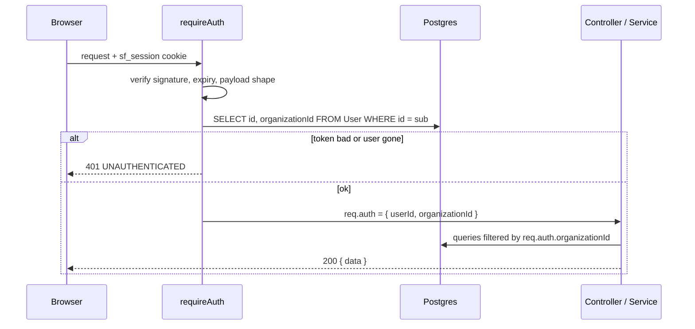

# Architecture

## Database and Prisma (Stage 1)

**Version:** Prisma 7.10.1, pinned exactly. The `latest` npm tag currently points at an 8.0 release
candidate, so the newest stable major (7.x) is used.

**Why the setup looks the way it does (Prisma 7 + Neon):**

| Concern                   | Decision                                                                                                                   |
| ------------------------- | -------------------------------------------------------------------------------------------------------------------------- |
| Runtime connection        | `@prisma/adapter-pg` over `DATABASE_URL` (Neon pooled recommended)                                                         |
| Migration connection      | `prisma.config.ts` derives the **direct** URL from `DATABASE_URL` (drops `-pooler`); poolers can't run migrations reliably |
| Tables at startup         | `npm run dev` and `npm start` run `prisma migrate deploy` first, so an empty database gets its tables automatically        |
| Generated client          | `src/generated/prisma` (gitignored); rebuilt by `prisma generate`, which every backend script runs first                   |
| Raw SQL migration         | CHECK constraints and `pg_trgm` indexes, which the Prisma schema cannot express                                            |
| Trigram indexes in schema | Declared as `@@index(... type: Gin)` only so drift detection does not try to drop them                                     |
| Tests                     | A separate Neon database (`TEST_DATABASE_URL`), migrated by vitest `globalSetup`, tables truncated per test                |

**Tenant model:** `Organization` is the tenant. `User` and `Product` carry `organizationId`; SKU is
unique per `(organizationId, sku)`. One owner per organization is enforced in the signup service (a
later stage), not by a unique FK, so multi-user organizations need no schema change.

## Authentication and tenant context (Stage 3)

- **Session**: JWT (HS256, claims `sub` = user id, `org` = organization id) in an `HttpOnly`
  cookie `sf_session`. The cookie `Max-Age` is derived from the same `JWT_EXPIRES_IN` value as the
  token, so they expire together.
- **SameSite=Lax**: the browser only talks to the frontend origin; the host rewrites `/api` to the
  API, making the cookie first-party. Lax stops cross-site POSTs; the Origin check is a second layer.
- **Tenant context**: `requireAuth` verifies the token, then loads the user from the database on
  every request and sets `req.auth = { userId, organizationId }` from that row. The `org` claim is
  deliberately NOT trusted, and no controller reads an organization id from body, query or params.
  Deleting a user revokes access immediately.
- **Signup** is one `prisma.$transaction` (organization, then user). The one-user-per-organization
  rule lives in the service, not the schema, so multi-user organizations stay a non-breaking change.
- **Rate limits** are in-memory (`express-rate-limit`), correct for one API instance; a scaled-out
  deploy would need a shared store.

## Stock status is shared (Stage 9)

`getEffectiveThreshold` and `getStockStatus` live in `@meridio/contracts` (`stock-status.ts`). The
backend re-exports them from `modules/inventory/stock-status.ts` and the product form imports them
for its live "Preview". One implementation means the preview can never disagree with the server.
The server value remains authoritative after a save.

## Deployment topology (Stage 12)

See [DEPLOYMENT.md](DEPLOYMENT.md) for the steps. The design decisions:

- **Same-origin API through a rewrite.** Vercel serves the SPA and rewrites `/api/*` to Render. The
  cookie is therefore first-party: `SameSite=Lax` is enough, no CORS credentials dance, and no
  backend URL in the React code (it lives only in `frontend/vercel.json`).
- **Builds need the repo root.** npm workspaces share one lockfile and `packages/contracts` must
  compile first. Render runs from the root; Vercel's Root Directory is `frontend/`, so its install and
  build commands start with `cd ..`.
- **One database variable.** `DATABASE_URL` is the only connection string. Runtime uses it as is
  (pooled recommended). `prisma migrate deploy` needs the direct address, which `prisma.config.ts`
  derives from the same URL. Migrations run at the start of `npm start`, so every deploy and cold start
  applies pending migrations first (this also avoids needing Render's separate pre-deploy command, which is not available on every plan).
- **Proxy awareness.** `TRUST_PROXY_HOPS` (2 in production) makes `req.ip` the real visitor, so rate
  limits apply per visitor instead of per proxy.
- **Cold-start tolerance.** The free Render tier sleeps; the client flags requests pending over 5
  seconds and shows a non-blocking notice. `/health/ready` (database check) is the platform health
  check; `/health/live` is the cheap wake-up ping.
- **Build-time guard.** `scripts/check-bundle.mjs` fails `npm run build` if the web bundle contains
  localhost URLs, DB URLs, secrets or the backend host.
