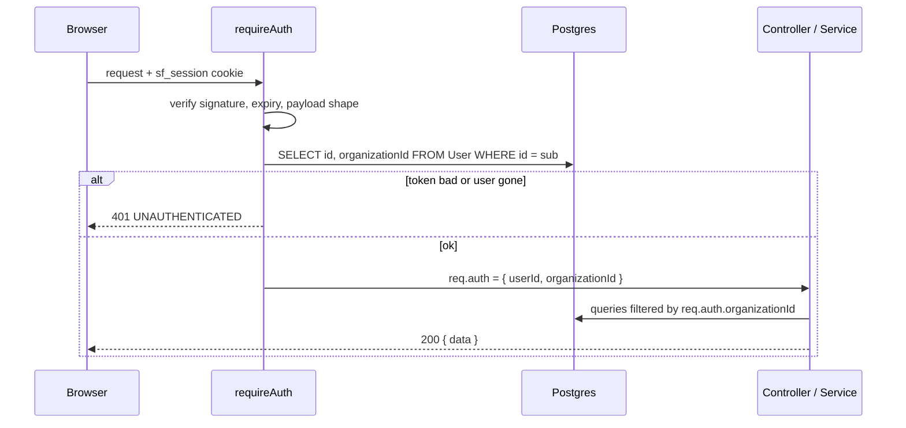

# Architecture

## Database and Prisma (Stage 1)

**Version:** Prisma 7.10.1, pinned exactly. The `latest` npm tag currently points at an 8.0 release
candidate, so the newest stable major (7.x) is used.

**Why the setup looks the way it does (Prisma 7 + Neon):**

| Concern                   | Decision                                                                                                    |
| ------------------------- | ----------------------------------------------------------------------------------------------------------- |
| Runtime connection        | `@prisma/adapter-pg` over Neon's **pooled** URL (`DATABASE_URL`)                                            |
| Migration connection      | `prisma.config.ts` uses the **direct** URL (`DIRECT_URL`); poolers can't run migrations reliably            |
| Generated client          | `src/generated/prisma` (gitignored); rebuilt by `prisma generate`, which every backend script runs first    |
| Raw SQL migration         | CHECK constraints and `pg_trgm` indexes, which the Prisma schema cannot express                             |
| Trigram indexes in schema | Declared as `@@index(... type: Gin)` only so drift detection does not try to drop them                      |
| Tests                     | A separate Neon database (`TEST_DATABASE_URL`), migrated by vitest `globalSetup`, tables truncated per test |

**Tenant model:** `Organization` is the tenant. `User` and `Product` carry `organizationId`; SKU is
unique per `(organizationId, sku)`. One owner per organization is enforced in the signup service (a
later stage), not by a unique FK, so multi-user organizations need no schema change.

## Authentication and tenant context (Stage 3)

- **Session**: JWT (HS256, claims `sub` = user id, `org` = organization id) in an `HttpOnly`
  cookie `sf_session`. The cookie `Max-Age` is derived from the same `JWT_EXPIRES_IN` value as the
  token, so they expire together.
- **SameSite=Lax**: the browser only talks to the frontend origin; the host rewrites `/api` to the
  API, making the cookie first-party. Lax stops cross-site POSTs; the Origin check is a second layer.
- **Tenant context**: `requireAuth` verifies the token, then loads the user from the database on
  every request and sets `req.auth = { userId, organizationId }` from that row. The `org` claim is
  deliberately NOT trusted, and no controller reads an organization id from body, query or params.
  Deleting a user revokes access immediately.
- **Signup** is one `prisma.$transaction` (organization, then user). The one-user-per-organization
  rule lives in the service, not the schema, so multi-user organizations stay a non-breaking change.
- **Rate limits** are in-memory (`express-rate-limit`), correct for one API instance; a scaled-out
  deploy would need a shared store.

## Stock status is shared (Stage 9)

`getEffectiveThreshold` and `getStockStatus` live in `@meridio/contracts` (`stock-status.ts`). The
backend re-exports them from `modules/inventory/stock-status.ts` and the product form imports them
for its live "Preview". One implementation means the preview can never disagree with the server.
The server value remains authoritative after a save.
