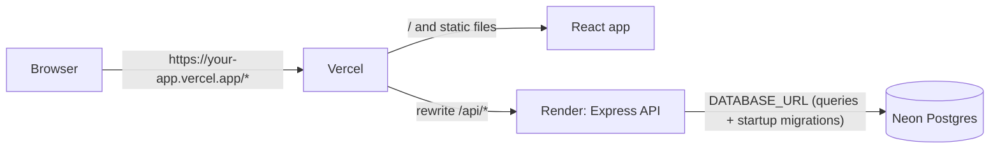

# Deployment guide (Neon + Render + Vercel)

StockFlow runs as three services:

| Part     | Service                  | What it hosts                                      |
| -------- | ------------------------ | -------------------------------------------------- |
| Database | **Neon** (PostgreSQL)    | Organizations, users, products                     |
| API      | **Render** (web service) | The Express API (`backend/`)                       |
| Web      | **Vercel**               | The React app (`frontend/`) and the `/api` rewrite |

The browser only ever talks to the **Vercel** address. Vercel forwards `/api/*` to Render, so the
session cookie is first-party and `SameSite=Lax` works with no CORS setup.



## Decisions worth knowing

- **Backend URL lives in one place**: `frontend/vercel.json`. The React code only calls relative `/api/v1/...`.
- **Both builds start at the repo root** because npm workspaces use the root lockfile and
  `packages/contracts` must be built before the API and the web app.
- **One Neon connection string**: `DATABASE_URL`. The API queries through it as is; for migrations
  Prisma derives the direct (non-pooled) address from the same URL by dropping `-pooler`.
- **Tables are created at startup.** The start command runs `prisma migrate deploy` before the API
  launches, so the first start on an empty database creates every table, and later deploys apply only
  new migrations. No manual migration step, and it works on Render's free plan.
- **`APP_ORIGIN` must equal your exact Vercel production URL.** The origin check on
  POST/PATCH/PUT/DELETE compares against it.
- **`TRUST_PROXY_HOPS=2`** on Render: requests pass through Vercel and Render's load balancer, and
  the real visitor IP (used by rate limiting) is two hops back. Too low and every visitor shares one
  rate-limit bucket; too high and visitors could spoof their IP.
- **Free-tier cold starts**: Render's free plan sleeps after inactivity, and the first request after
  that can take up to about a minute. The web app shows a "Waking up the server" notice after 5
  seconds of a pending request. Before a demo, open `<render-url>/api/v1/health/live` once (or use a
  free uptime monitor) to wake it.

## 1. Neon (database)

1. Create a Neon project, or a **new database / branch dedicated to production**. Do **not** reuse
   the development or test database.
2. From _Connection details_ copy the connection string (the **pooled** one, whose host contains
   `-pooler`, is recommended; a direct one also works). This is `DATABASE_URL`.
3. It must end with `sslmode=require` (Neon's default).
4. **Do not run the seed in production.** The demo logins are for development only.

## 2. Render (API)

Option A, Blueprint: in Render choose _New > Blueprint_, connect the GitHub repo and select
`render.yaml`. Render prompts for the two values marked `sync: false` (`DATABASE_URL`, `APP_ORIGIN`).

Option B, manual: _New > Web Service_, connect the repo, then:

| Setting           | Value                                                                                     |
| ----------------- | ----------------------------------------------------------------------------------------- |
| Runtime           | Node                                                                                      |
| Root Directory    | _(leave empty: repo root)_                                                                |
| Build Command     | `npm ci --include=dev && npm run build -w packages/contracts && npm run build -w backend` |
| Start Command     | `npm run start -w backend` (applies migrations, then starts the API)                      |
| Health Check Path | `/api/v1/health/ready`                                                                    |
| Plan              | Free                                                                                      |

`--include=dev` matters: Render builds with `NODE_ENV=production`, which would otherwise skip
TypeScript and Prisma, both needed to build.

Environment variables:

| Name               | Value                                       | Notes                                                 |
| ------------------ | ------------------------------------------- | ----------------------------------------------------- |
| `NODE_ENV`         | `production`                                | Turns on the `Secure` cookie flag                     |
| `DATABASE_URL`     | Neon connection string (pooled recommended) | Queries and startup migrations                        |
| `JWT_SECRET`       | 32+ random characters                       | Blueprint generates one; or `openssl rand -base64 48` |
| `JWT_EXPIRES_IN`   | `7d`                                        | Session lifetime (also the cookie `Max-Age`)          |
| `APP_ORIGIN`       | `https://your-app.vercel.app`               | Exact Vercel URL, no trailing slash or path           |
| `TRUST_PROXY_HOPS` | `2`                                         | See "Decisions" above                                 |

The server listens on Render's `PORT` at `0.0.0.0` automatically.

After the first deploy, note the service URL (`https://<name>.onrender.com`) and check
`https://<name>.onrender.com/api/v1/health/ready` returns `{"data":{"status":"ready"}}`.

## 3. Vercel (web)

1. _Add New > Project_, import the same repo.
2. Set **Root Directory** to `frontend` and keep _Include source files outside of the Root Directory
   in the Build Step_ **enabled** (the default). The build needs `packages/contracts` and the root
   lockfile, which live outside `frontend/`.
3. Framework Preset: **Vite**. Then override these three (the same values are in
   `frontend/vercel.json`, so they apply automatically; typing them in the dashboard is harmless):

   | Setting          | Value                                                                                                                      |
   | ---------------- | -------------------------------------------------------------------------------------------------------------------------- |
   | Install Command  | `cd .. && npm ci`                                                                                                          |
   | Build Command    | `cd .. && npm run build -w packages/contracts && npm run build -w frontend && node scripts/check-bundle.mjs frontend/dist` |
   | Output Directory | `dist`                                                                                                                     |

   Why not the defaults (`npm run build`, `vite build`): the web app imports the shared
   `@meridio/contracts` package, which must be built first, and the install must run at the repo root
   so npm workspaces link it. The last step fails the deploy if the bundle contains localhost URLs,
   database URLs or secrets.

4. The backend address is already set in `frontend/vercel.json`
   (`https://meridio-g01d.onrender.com/api/:path*`). It is the only file that contains it.
5. The rewrite order matters: `/api/:path*` first, then the `/(.*)` fallback to `index.html`. The
   fallback makes a refresh on `/products` work. The `x-vercel-enable-rewrite-caching: 0` header
   stops Vercel caching API responses.
6. Deploy. Copy the production URL.
7. Go back to Render and set `APP_ORIGIN` to that exact URL, then redeploy the API.

## 4. Verify

```bash
npm run smoke:prod -- https://your-app.vercel.app
```

It checks readiness, signup, the cookie flags (`HttpOnly`, `Secure`, `SameSite=Lax`), `/auth/me`,
creating a product, the dashboard, logout and the 401 afterwards. It exits non-zero on any failure
and leaves one throwaway user, organization and product in the database.

Then repeat the demo by hand in a browser: sign up, add a product, see it on the dashboard, edit
the quantity below the threshold, change the default threshold in Settings, search by SKU, delete a
product, log out, refresh `/products` while signed out (it should redirect to `/login`).

## Click-path checklist

- [ ] Neon production database created; connection string copied
- [ ] Render service created from `render.yaml` (or manually); env vars set
- [ ] Render deploy is green; `/api/v1/health/ready` returns ready
- [ ] `frontend/vercel.json` points at the real Render address (already set), committed, pushed
- [ ] Vercel project deployed; production URL copied
- [ ] Render `APP_ORIGIN` set to that exact URL; API redeployed
- [ ] `npm run smoke:prod -- <vercel-url>` passes
- [ ] Manual demo in the browser works, including a refresh on `/products`
- [ ] README live-link placeholders filled in

## Troubleshooting

| Symptom                                                           | Likely cause and fix                                                                                                                                                                                        |
| ----------------------------------------------------------------- | ----------------------------------------------------------------------------------------------------------------------------------------------------------------------------------------------------------- |
| Login works but you are logged out on the next request            | Cookie not stored. Check you are using the **Vercel** URL (not the Render URL) and that `NODE_ENV=production` is set on Render (Secure cookie needs HTTPS, which both provide).                             |
| `403 FORBIDDEN_ORIGIN` on sign up, log in or any save             | `APP_ORIGIN` on Render does not exactly match the URL in the browser address bar (check `https`, `www`, trailing slash, preview URLs). Preview deployments have different URLs; test on the production URL. |
| `/api/...` returns the web app's HTML or a 404 page               | The `/api/:path*` rewrite in `frontend/vercel.json` is missing, comes after the fallback, or has the wrong Render address.                                                                                  |
| Refreshing `/products` gives 404                                  | The SPA fallback rewrite (`/(.*)` to `/index.html`) is missing from `frontend/vercel.json`.                                                                                                                 |
| Everyone gets `429 RATE_LIMITED` quickly                          | `TRUST_PROXY_HOPS` is too low, so all visitors share one IP. Set it to `2` on Render.                                                                                                                       |
| Render build fails with `tsc: not found` or `prisma: not found`   | Build command is missing `--include=dev`.                                                                                                                                                                   |
| Deploy fails while starting, with a Prisma migration error        | `DATABASE_URL` is wrong, or the Neon database is unreachable or suspended. Run `npm run db:deploy -w backend` locally with the same value to see Prisma's message.                                          |
| Service crashes at start with "Invalid environment configuration" | The log lists which variables are missing or invalid (never their values). Fix them in the Render dashboard.                                                                                                |
| First page load hangs for up to a minute                          | Free-tier cold start. The "Waking up the server" notice appears after 5 seconds; wake the API ahead of demos.                                                                                               |
| `500` on every database call                                      | Check `DATABASE_URL` (pooled, `sslmode=require`) and that the Neon project is not suspended.                                                                                                                |

## Rollbacks and changes

- Migrations only move forward. To change the schema, add a new migration; never edit an applied one.
- To roll back the app, redeploy a previous commit on Render/Vercel. The database keeps its schema.
- Rotating `JWT_SECRET` signs everyone out (their cookies stop verifying), which is safe and instant.

## Vercel build fails: "Cannot find module @meridio/contracts" or lockfile errors

The Root Directory is `frontend`, so Vercel must be allowed to read files outside it. In the project
settings under _Build and Deployment > Root Directory_, enable _Include source files outside of the
Root Directory in the Build Step_, then redeploy.
